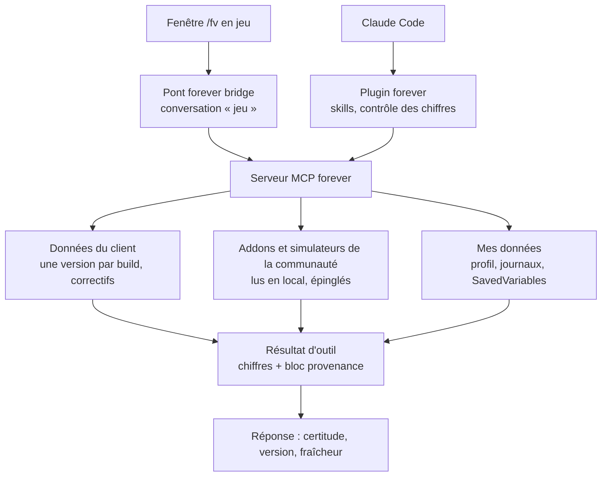

# WoW Forever — système expert

Un assistant pour *World of Warcraft: Forever* qui **lit et recoupe** au lieu de deviner. On lui parle en français,
dans le jeu (fenêtre du pont ForeverBridge) ou dans Claude Code ; la réponse arrive avec ses chiffres, la version du
jeu d'où ils viennent et le degré de confiance qu'on peut leur accorder. Toutes les classes sont servies.

---

## 1. Ce que c'est

Forever est une version à part de World of Warcraft : talents, sorts, quêtes et monstres n'y sont pas ceux de la
Classic, et un modèle de langage interrogé de mémoire y répond avec assurance des chiffres faux. Ce projet prend le
problème dans l'autre sens :

- **Les données viennent du client du jeu** (tables décodées, correctifs du serveur) et de **mes addons**, lus sur le
  disque ;
- **les calculs viennent de ce que la communauté maintient déjà** : wowsims/forever au niveau maximal, Talents
  Forever, Naowh Forever, Forever Companion, GearQuest Forever, SkillUp Forever, Questie, les parcours gratuits de
  RestedXP et les guides de Polestar. Notre propre moteur ne sert qu'en recoupement et pour combler les trous ;
- **l'IA ne calcule rien** : elle comprend la question, appelle le bon outil et rédige la réponse.

Règle absolue : **Forever seulement**. Rien de Season of Discovery ni de la Classic, ni données ni mécanismes ; une
source qui ne couvre pas Forever n'est pas prise.

### Ce que je peux faire en jeu

`/fv` ouvre la fenêtre du pont. Une barre latérale donne accès à tout :

| Écran | Ce qu'il fait |
|---|---|
| **Chat** | Une question en français, réponse en quelques secondes avec sa ligne de provenance ; Maj+clic sur un objet, un sort, une quête ou un talent pour l'inclure ; plusieurs conversations en parallèle |
| **Feuille de route** | Route de leveling calculée depuis ma position, calée sur le parcours gratuit de RestedXP de ma race et de ma classe, puis sur les guides de Polestar au-delà ; quêtes de classe et donjons ajoutés ; « Valider et livrer » l'envoie dans RestedXP |
| **Talents** | Plan de talents dès le niveau 1, lien Talents Forever (`/tf import`) et code Naowh à importer ; pour une classe autre que le Mage, builds populaires de Talents Forever et build de Forever Companion |
| **Équipement** | Objets obtenables à mon niveau, pris d'abord sur ma route ; liste BiS ; « est-ce une amélioration ? » ; route d'équipement livrée dans RestedXP. Poids des statistiques : wowsims/forever au niveau 60, sinon Forever Companion, Naowh ou le moteur du Mage |
| **Exports** | Chaînes à coller soi-même : build et macros Naowh Forever, poids Naowh et échelle Pawn de Forever Companion, liste BiS Naowh, profil EllesmereUI (éteint par défaut) |
| **Mises à jour** | Carte « Mis à jour » : ce que la veille vient d'installer, en mots de joueur, avec « Annuler » |
| **Aide** | Les commandes de la fenêtre |

L'addon ne joue jamais à ma place : aucune fonction d'action, aucune lecture du journal de combat en jeu ; les
macros et les profils sont du texte que j'importe moi-même. Rien ne modifie EllesmereUI sans demande explicite.

### Ce qui est calculé, et par qui

| Sujet | Source du calcul |
|---|---|
| Niveau 60, toutes les classes de dégâts : dégâts, meilleure race, poids | wowsims/forever, compilé tel quel et épinglé (certitude `suppose`) |
| Mage sous le niveau 60 : build, temps par monstre, XP par heure | Notre moteur, **gelé** ; il le dit dans sa réponse et se recoupe sur mes journaux |
| Autres classes sous le niveau 60 | Addons de la communauté (Talents Forever, Forever Companion, Naowh), mes journaux, sinon « non calculé » |
| Routes de leveling | Parcours gratuits de RestedXP, puis Polestar ; acceptées seulement si elles leur ressemblent |
| Quêtes, donjons, butin, PvP, familiers du Chasseur | Client du jeu, addons de données lus en local, mes relevés |

Ce qui n'est pas couvert (champs de bataille, Legacy, réputations, hôtel des ventes, analyse de mes combats…)
reçoit un « je ne sais pas » qui cite la tranche prévue :
[docs/USAGE.md](docs/USAGE.md#ce-que-le-plugin-ne-sait-pas-encore). L'ordre des travaux :
[docs/ROADMAP.md](docs/ROADMAP.md).

---

## 2. Comment ça marche



### L'IA ne calcule jamais

**Chaque chiffre d'une réponse est recopié tel quel d'un résultat d'outil.** Le dépôt ne contient aucun chiffre de
jeu hors de `forever/data/` (ni dans le plugin, ni dans un skill, ni dans l'addon). Dans Claude Code, un contrôle relit
chaque réponse et signale par `[forever:chiffres]` tout nombre qui ne vient d'aucun outil.

### Certitude et provenance

Chaque résultat porte un bloc `provenance` : version du jeu, empreinte et révision des données, date, fraîcheur,
hypothèses, et une **certitude** :

| Certitude | Ce que ça veut dire |
|---|---|
| `certain` | Lu dans le client, ou observé en jeu dans mes journaux |
| `probable` | Calculé ou recoupé entre deux sources (correctifs lus chez Raidbots compris) |
| `suppose` | Estimé, tiré d'un addon, d'un simulateur de la communauté ou d'un guide — à vérifier en jeu |

Une règle du jeu incertaine n'est jamais devinée : elle est marquée `suppose` et la question part dans
[docs/OPEN_QUESTIONS.md](docs/OPEN_QUESTIONS.md). Les mécaniques modélisées ont leur entrée dans
[docs/MECHANICS_REGISTRY.yaml](docs/MECHANICS_REGISTRY.yaml).

### Mise à jour automatique

La veille (`forever update --auto`) tourne seule : au démarrage d'une session Claude Code dans le dépôt, chaque jour
à 08:00 par une tâche planifiée, et à la fermeture du jeu par le pont. Elle **installe d'elle-même** toute nouvelle
version du client, tout correctif du serveur, les addons de données relus, les guides de Polestar et wowsims/forever
(recompilé s'il l'a déjà été), puis **prévient** : carte « Mis à jour » en jeu et `forever update status`, avec « Annuler »
(`forever update undo <id>`). Elle ne s'arrête et ne le dit que si l'intégrité casserait, si une source est
injoignable, ou si une valeur écrite à la main ou un correctif du serveur serait perdu.

---

## 3. Installation sur un PC Windows

### Prérequis

- [Git for Windows](https://git-scm.com/download/win) (il fournit aussi le bash des hooks) ;
- [uv](https://docs.astral.sh/uv/getting-started/installation/) — il installe Python, `pip` n'est jamais utilisé ;
- [Claude Code](https://claude.com/claude-code) (commande `claude`, connecté) ;
- le client de World of Warcraft: Forever ;
- pour wowsims/forever (facultatif) : Go et `protoc`.

### Installer

```powershell
git clone <adresse du dépôt> wow-forever
cd wow-forever
powershell -ExecutionPolicy Bypass -File scripts\install_plugin.ps1
```

Le script, relançable sans risque, pose `FOREVER_HOME` et `FOREVER_WOW_DIR`, lance `uv sync`, installe le plugin
`forever` au niveau utilisateur et contrôle que tout répond. **Ouvrir ensuite un nouveau terminal.** Puis, jeu fermé :

```powershell
uv run python scripts/install_addon.py                                   # ForeverLogger
uv run forever bridge install                                            # ForeverBridge
uv run forever bridge autostart install                                  # pont lancé à chaque ouverture de session
powershell -ExecutionPolicy Bypass -File scripts\install_update_task.ps1 # veille chaque jour à 08:00
uv run forever sims update                                               # wowsims/forever (facultatif)
uv run forever doctor                                                    # contrôle de toute l'installation
```

Le détail (variables, second PC, mise à jour) : [docs/USAGE.md](docs/USAGE.md). Jour du lancement (4 novembre) :
[docs/LANCEMENT.md](docs/LANCEMENT.md), une section par PC. Règles de l'addon : [docs/ADDON.md](docs/ADDON.md).

---

## 4. Utilisation

- **En jeu** : `/fv`, puis la barre latérale (section 1).
- **Dans Claude Code** : lancer `claude` dans n'importe quel dossier et poser la question en français.
- **Avec une autre IA** : le serveur MCP (`uv run --directory <dépôt> forever mcp`) se branche dans tout client MCP
  local (Claude Desktop, Codex CLI, Gemini CLI, Cursor) ; on y perd le routeur des skills et le contrôle des chiffres.
- **En ligne de commande** : les commandes utiles sont dans [docs/USAGE.md](docs/USAGE.md#en-ligne-de-commande).
  Chacune accepte `--json` et rend le même bloc `provenance`.

---

## 5. Données

- **Une version de données par version du jeu**, dans `forever/data/`, avec l'empreinte de chaque fichier ; une
  correction sans changement de version devient une **révision**. Empreinte fausse : les outils refusent de répondre.
- **Hiérarchie des sources** : le client du jeu d'abord, puis mes observations, puis les addons et simulateurs de la
  communauté, puis les guides ; un écart est signalé, jamais tranché au hasard. Détail :
  [docs/DATA_SOURCES.md](docs/DATA_SOURCES.md).
- **Addons lus en local**, jamais par le réseau ni dans les tests ; seuls des agrégats entrent dans le dépôt.
- **Aucune donnée personnelle dans le dépôt** : profil, journaux et sauvegardes restent sur le PC.

---

## 6. Dépannage

| Symptôme | Remède |
|---|---|
| Quelque chose ne marche plus | `uv run forever doctor` : une ligne par contrôle, la correction dessous |
| La fenêtre `/fv` ne répond pas | `uv run forever bridge status` ; relancer le pont (voir [docs/USAGE.md](docs/USAGE.md#le-pont-forever-bridge)) |
| Une mise à jour a cassé un conseil | Carte « Mis à jour », « Annuler » ; ou `uv run forever update undo <id>` |
| Le plugin ne tient pas compte d'une mise à jour | Redémarrer Claude Code |
| « Le serveur forever ne répond pas » | `FOREVER_HOME` absent ou faux : relancer `scripts\install_plugin.ps1` depuis le dépôt, puis un nouveau terminal |
| Fraîcheur `stale`, `unknown` ou `silent` | `uv run forever status` ; la veille rattrape seule, `uv run forever update status` dit où elle en est |

---

## 7. Structure du dépôt

```
forever/        cœur Python : données versionnées, lecteurs, adaptateurs, moteur, CLI, serveur MCP, pont
plugin/         plugin Claude Code : skills, sous-agents, hooks, évaluation — aucun calcul, aucun chiffre
addon/          ForeverLogger et ForeverBridge (lecture seule, aucune action)
scripts/        installation, tâches planifiées, contrôles
tests/          unitaires, intégration, golden, fixtures
docs/           spécification, architecture, feuille de route, décisions, sources, registre des mécaniques
tasks/          plans des tranches
seed/           code de référence validé (lecture seule)
```

| Document | Contenu |
|---|---|
| [docs/USAGE.md](docs/USAGE.md) | Mode d'emploi, au jour le jour |
| [docs/LANCEMENT.md](docs/LANCEMENT.md) | Pas-à-pas du 4 novembre |
| [docs/ADDON.md](docs/ADDON.md) | Règles des addons et procédures d'essai en jeu |
| [docs/DECISIONS.md](docs/DECISIONS.md) | Chaque choix, sa raison, et ce qui a été écarté |
| [docs/ROADMAP.md](docs/ROADMAP.md) | Les tranches de travail, dans l'ordre |
| [docs/SPEC.md](docs/SPEC.md) | Ce que le système doit savoir faire |
| [docs/ARCHITECTURE.md](docs/ARCHITECTURE.md) | Comment c'est construit |
| [docs/DATA_SOURCES.md](docs/DATA_SOURCES.md) | D'où vient chaque donnée |
| [docs/DEVELOPMENT.md](docs/DEVELOPMENT.md) | Comment ce projet se développe |
| [CLAUDE.md](CLAUDE.md) | Les invariants que l'agent respecte en permanence |
